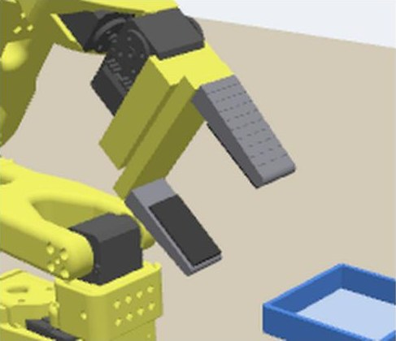
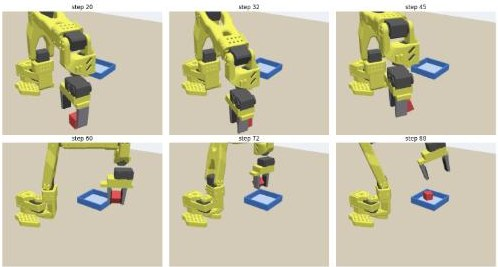

# SO-101 Pick & Place 第2版：2本指グリッパ × 摩擦把持（ROS 2 × Gazebo × LeRobot / Colab）

Physical AI 講座 2026 応用編1（omnicampus: maty0505）。
[第1版（first_model）](https://github.com/pai-claude-maty0505/first_model) のタスク「赤いブロックを掴んで青いトレイに入れる」を、より実機に近い把持方式に作り直したものです。
**データ作成 → 学習 → 推論（自律実行）** の全工程を Google Colab（T4 GPU）だけで実行します。

## 第1版からの変更点

| | 第1版 | 第2版（このリポジトリ） |
|---|---|---|
| ハンド | SO-101 純正のジョー（片側だけが動く） | **平行2本指グリッパ**（左右の指が直動関節で対称に開閉） |
| ブロック | 指とは衝突しない設定（見た目上、指が食い込む） | 指・トレイ・机と衝突する**剛体** |
| 把持 | 閉じたら DetachableJoint で固定（把持アシスト） | **指で挟んだ摩擦力だけ**で保持。固定・吸着などの補助なし |
| 行動の 6 次元目 | ジョーの角度 (rad) | 指の開き幅 (m、左右共通) |

### グリッパの仕組み
- 元のモデルから可動ジョーと固定ジョー（`wrist_roll_follower` 部品）を外し、掌・レール・左右の指（直動関節 `finger_left` / `finger_right`）を URDF に追加（`build_sim.py`）。
- 各指は力の上限付きの位置制御。ブロックの内側（開き幅 0）を目標にすると、指がブロックに当たって止まり、その力で挟む。
- 各指の内側に厚さ 3 mm のラバーパッド（黒、摩擦係数 5.0）。指の本体（樹脂、摩擦係数 1.0）は根元 10 mm から先端 6 mm へ 10 段階でなだらかに細くなり、先端は丸い。
- ブロックは 2.5 cm 角・30 g の剛体（摩擦係数 5.0）。
- 各指の把持力は最大 15 N（PID の出力上限）。
- TCP（手先の基準点）は第1版と同じ位置なので、逆運動学は第1版のものをそのまま使用。
- ブロックの向きは毎回、指の閉じる方向に面がそろう向き ±約 9° のばらつきで置く。

## パイプライン

```
 Gazebo Harmonic (headless) : SO-101 + 2本指グリッパ / 剛体ブロック / トレイ / カメラ×2
        ▲ 関節目標・指の開き          │ 画像・関節状態
 ROS 2 node so101_task_node.py (Python 3.12)
   collect: IK エキスパート → 生データ (.npz)  /  eval: TCP で推論サーバに問い合わせ
   to_lerobot.py → LeRobotDataset → lerobot-train (ACT, Colab GPU)
                                      policy_server.py (LeRobot ACT, Python 3.13)
```

| ファイル | 内容 |
|---|---|
| `PAI_second_SO101_parallel_gripper.ipynb` | Colab ノートブック（全工程を順に実行） |
| `docs/説明資料_PAI最終課題_maty0505.pdf` | 説明資料（レポート） |
| `sim/build_sim.py` | URDF の改造（2本指グリッパ）、URDF→SDF 変換、衝突・摩擦・コントローラ設定、ワールド生成 |
| `sim/so101_task_node.py` | ROS 2 ノード（データ収集 / ポリシー実行、実際のブロック位置による成功判定） |
| `sim/so101_kin.py` | URDF を直接読む FK/IK |
| `sim/bridge.yaml` | ROS 2 ⇔ Gazebo トピック対応 |
| `sim/snapshot.py` | 動作確認（関節指令とカメラ画像） |
| `learning/to_lerobot.py` | 生データ → LeRobotDataset (v3) |
| `learning/policy_server.py` | 学習済み ACT の推論サーバ |
| `learning/make_video.py` | 提出用動画の自動合成（`--only_success` で成功例のみ） |
| `derive_second.py` | 第1版のファイルから第2版の一部ファイルとノートブックを生成する補助スクリプト |

## 実行方法
1. `PAI_second_SO101_parallel_gripper.ipynb` を Colab で開き、ランタイムを **T4 GPU** にする
2. 上から順に実行（環境構築 約15分 → 把持テスト → データ収集 → 学習 約70分 → 評価・動画）
3. 成果物は Google Drive の `MyDrive/PAI_second/` に保存される

## 結果





| 項目 | 値 |
|---|---|
| 把持テスト（ラバーパッド付きの指、エキスパート） | 5 回中 5 回成功 |
| エキスパートデモ | 65 回中 60 回成功、5,883 フレーム（10 Hz） |
| ACT 学習 | 10,000 ステップ（バッチ 32）、損失 1.447 → 0.065 |
| 自律実行（同じ 10 か所の配置で比較） | 学習時の設定：**4/10**、5 ステップごとに再推論：3/10、時間的アンサンブル：**5/10** |

成功した自律実行の動画（1 例、等倍速・約 10 秒、予行演習として限定公開）：https://youtu.be/V9LoSGFUvSE

### 考察
- 摩擦だけで挟む方式では、手先の位置と指を閉じるタイミングのわずかなずれで失敗する。第1版（固定方式、9/10）より難しい。
- 失敗の大半は「つかみ損ねてブロックが元の位置に残る」もの。時間的アンサンブル（毎ステップ推論し、重なった予測を平均）で動きが滑らかになり、ブロックを弾き飛ばす失敗はなくなった。
- 改善案：デモの追加（60 → 120 本）、つかみ損ねたときにやり直す動きを含むデモ、画像の水増し。

### 推論の設定
`learning/policy_server.py` は次のオプションに対応しています。
- `--n_action_steps N`：アクションチャンク（20 ステップ）のうち先頭 N ステップを実行して再推論（学習時は 10）
- `--temporal_ensemble 0.01`：毎ステップ推論し、重なった予測を指数重みで平均（ACT の temporal ensembling）

## 使用モデル・ライブラリ
- SO-101 モデル：[TheRobotStudio/SO-ARM100](https://github.com/TheRobotStudio/SO-ARM100)（Apache-2.0）。グリッパ部分は本リポジトリで改造
- [LeRobot](https://github.com/huggingface/lerobot) 0.6.1（ACT）
- ROS 2 Jazzy, Gazebo Harmonic, ros_gz

## AI の活用
- 模倣学習ポリシー ACT（LeRobot）がロボットを制御
- 開発過程で生成 AI アシスタントをコード作成・デバッグの補助に使用
